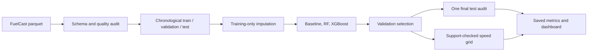

# Ship Fuel Prediction and Supported Speed Comparison

M.Tech engineering prototype using all three vessels from the [FuelCast dataset](https://huggingface.co/datasets/krohnedigital/FuelCast). It predicts total instantaneous fuel flow with vessel-specific models, compares a cubic baseline with Random Forest and XGBoost, evaluates three future windows, and explores constant-speed voyage alternatives inside empirical training support.

## Verified result

Fixed-split validation selected environmental XGBoost for CPS Triton and OSS Ceto, and the cubic baseline for CPS Poseidon. Final-test MAE/R² were **0.01837/0.834**, **0.07510/0.950**, and **0.04570/0.579**, respectively. Across three additional future windows, environmental XGBoost produced the lowest mean MAE for every vessel, although Poseidon and Ceto showed substantial temporal variation. These are vessel-specific results, not cross-vessel transfer results.

## Architecture



## Setup on Windows

Python 3.12 is recommended.

```powershell
py -3.12 -m venv .venv
.\.venv\Scripts\python.exe -m pip install -r requirements.txt
.\.venv\Scripts\python.exe -m pip install -e . --no-deps
.\.venv\Scripts\python.exe scripts\download_data.py
.\.venv\Scripts\python.exe scripts\inspect_data.py
.\.venv\Scripts\python.exe scripts\run_multi_vessel.py
.\.venv\Scripts\python.exe -m pytest -q
.\.venv\Scripts\streamlit.exe run app\streamlit_app.py
```

Open `http://localhost:8501`. Training is CPU bounded to two threads. Dashboard interactions load saved artifacts and do not retrain models.

## Data and units

FuelCast combines five-minute onboard operational measurements with externally derived and interpolated weather/environment data. The target `Consumer_Total_MomentaryFuel` is total momentary mass flow in kg/s. `Ship_SpeedOverGround` is m/s. The source provides a sequence index rather than calendar timestamps. Water-speed availability is inconsistent: Triton is constant, Poseidon varies, and Ceto has no STW field. The common experiment therefore uses SOG for all vessels.

Raw parquet is ignored by Git. The downloader pins repository revision `eb6a6ec011c1c9a2cbce21459e22be4c77ef84dd` and verifies the previously inspected file hash when the inspection report is present. Full verification is in [reports/data_verification.md](reports/data_verification.md).

## Evaluation design

- Separate 60/20/20 time regions per vessel, with one-day/288-index embargoes.
- Three additional expanding-window evaluations for the cubic baseline, speed-only XGBoost and environmental XGBoost.
- Model selection uses validation MAE. The selected training-fitted pipeline is frozen and evaluated once on the test block.
- Median imputation is fitted within each training pipeline.
- Engine power, rotation speed, shaft response and all fuel-related inputs are excluded to reduce target leakage and downstream-response shortcuts.
- Relative source directions are encoded as sine/cosine components against vessel bearing.

## Voyage comparison

For each supported grid speed, the dashboard calculates `time = distance / SOG` and `fuel mass = predicted kg/s × seconds`. It enforces the travel-time constraint, speed envelope and a local 10-neighbour training-support test. It handles infeasible voyages explicitly.

This module is exploratory. SOG is not speed through water. Holding weather, currents and other context fixed while changing speed is a model scenario, not a causal intervention. Estimated savings are not sea-trial-verified savings. The 90th-percentile validation absolute error is shown as a sensitivity quantity, not a guaranteed confidence interval.

## Prediction uncertainty

Each vessel bundle contains finite-sample split-conformal absolute-residual radii calibrated on its validation block. Speed regimes use separate radii when at least 100 calibration observations are available. Overall observed final-test coverage for nominal 90% intervals is 89.8% for Triton, 93.6% for Poseidon and 79.4% for Ceto. Ceto's undercoverage is evidence of temporal distribution shift, so the dashboard never presents 90% as a guaranteed future coverage level.

## Key limitations

The project trains separate models and does not test transfer to an unseen vessel. Ceto is dominated by near-stationary operation, while the cruise ships contain more transit observations, so raw metrics are not directly interchangeable. Poseidon’s fixed validation split prefers a cubic baseline even though environmental XGBoost has lower mean MAE across repeated windows; this demonstrates temporal instability. Weather variables are interpolated historical products, forecast error is absent, and support checks cannot prove operational achievability. Draft, route intent, maintenance and hotel-load context are incomplete.

## Reproducibility and outputs

Configuration is in `configs/config.yaml`; source hashes and vessel metadata are stored under `models/<vessel>/`. Executed outputs are in `reports/metrics/`, figures in `reports/figures/`, and thesis-ready text in `reports/thesis_material/`. Major choices are recorded in `decisions.md`; pipeline details in `flow.md`; experiment results in `experiments.md`.

## Citation and licence

J. Viga, P. Mueck, A. Löser and T. Weis, “FuelCast: Benchmarking Tabular and Temporal Models for Ship Fuel Consumption,” 2026. Preprint: https://arxiv.org/abs/2510.08217

The dataset repository declares **CC BY-NC-ND 4.0**. Preserve attribution and consult the licence before redistributing source data or derived datasets. Raw data is intentionally excluded from version control.
