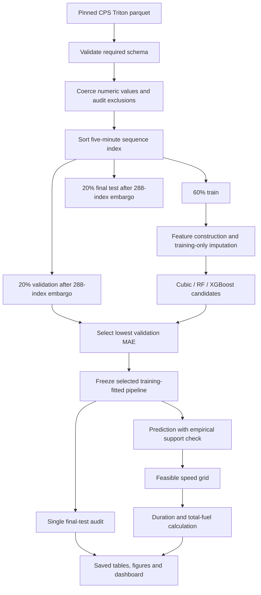

# System flow

The loader validates the common real schema separately for CPS Triton, CPS Poseidon and OSS Ceto. Cleaning records every exclusion. No quantile outlier filter is used. Environmental gaps remain in processed data and are imputed inside model pipelines using vessel-specific training medians.

Prediction inputs contain ground speed, environmental scalar variables and relative-direction sine/cosine terms. They exclude fuel, engine speed, shaft power and propeller variables. Model selection uses validation MAE. Test metrics are descriptive evidence for one future block and never feed selection.

Each vessel receives an independent inference bundle containing its selected pipeline, feature order, validation error sensitivity, speed envelope and training-only nearest-neighbour support model. Three expanding-window tests additionally compare the cubic baseline and both XGBoost feature sets at 55%, 70% and 85% sequence positions. The optimizer duplicates one observed vessel-specific environmental snapshot over a speed grid, predicts fuel rate, rejects unsupported combinations, applies the arrival-time constraint, then minimizes calculated voyage fuel among feasible grid points. The dashboard calls this shared logic and never trains a model.
